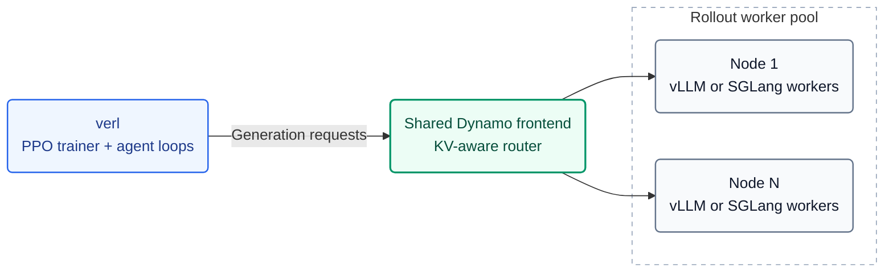

# Dynamo rollout backend for verl

Run verl training with **vLLM or SGLang** behind Dynamo's **KV-aware router**.
The recipe supports shared or separate training/rollout GPUs, weight updates,
and engine sleep/wake. All training launchers use `verl.trainer.main_ppo`.

[Architecture](#architecture) · [Quick start](#quick-start) ·
[Configuration](#configuration) · [Results](#results) · [Key files](#key-files)

## Architecture



**One frontend per rollout pool, shared across nodes and replicas.** Ray manages
one server actor per node; only the pool's first node starts the frontend,
etcd and NATS. Workers publish KV-cache events for routing. Weight updates use
node-local CUDA IPC; separate pools receive weights through verl's checkpoint
engine before applying them locally.

## Quick start

### Required versions

Use separate environments for the two inference engines. The tested versions are:

| Component | Version |
| --- | --- |
| Python | 3.12 |
| verl | [6cbca9ce](REQUIRED_VERL.txt) |
| Dynamo | [8c5a737](https://github.com/ai-dynamo/dynamo/commit/8c5a73723109058f96c15fff3fc912231d65ad6e), after [PR #13951](https://github.com/ai-dynamo/dynamo/pull/13951) |
| Inference engine | vLLM 0.28.0 **or** SGLang 0.5.19 |
| V1 trainer | TransferQueue 0.1.9; CuPy matching CUDA for the separate-pool NCCL backend |

For **Uni-Agent + vLLM 0.24 + ThunderAgent + V1 async**, use the dedicated
[usage guide](THUNDERAGENT_VLLM024.md) and its pinned versions and launcher.
Its [fully async launcher](run_uniagent_thunderagent_vllm024_fully_async.sh)
uses separate 8-GPU training and 8-GPU rollout pools.

### Install Dynamo

Run in an activated Linux Python 3.12 environment with verl and the selected
engine installed. Rust/system libraries, `uv` and `maturin` must be available;
see the [installation guide](INSTALL.md) for prerequisites.

```bash
export DYNAMO_SRC=/path/to/dynamo
cd "$DYNAMO_SRC"
git checkout 8c5a73723109058f96c15fff3fc912231d65ad6e
python3 -m uv build --wheel
cd "$DYNAMO_SRC/lib/bindings/python"
python3 -m maturin build --release --locked --features kv-indexer --out "$DYNAMO_SRC/dist"
python3 -m uv pip install --python "$(command -v python3)" \
    --reinstall-package ai-dynamo --reinstall-package ai-dynamo-runtime \
    "$DYNAMO_SRC"/dist/ai_dynamo*.whl 'protobuf>=6.33.5,<7'
export PYTHONPATH="$DYNAMO_SRC/components/src${PYTHONPATH:+:$PYTHONPATH}"
```

This builds both wheels into `dist/`, installs them into the active interpreter,
and loads Python components from the matching checkout. Keep only the two
wheels from this build in `dist/`. For this text-only recipe, the reduced feature
set keeps Cargo defaults and adds `kv-indexer`; KV routing is enabled at runtime
with `router_mode=kv`. The [DFW build details](https://github.com/verl-project/verl-recipe/blob/5451026758c3f1dc3ebc2a46a0e52b14406f0f72/dynamo/INSTALL.md#dfw-benchmark-build)
record the additional features used for the published results.

Run training from the verl checkout with this repository at `recipe/`. Keep
`etcd` and `nats-server` on `PATH`; for SGLang, unset `PYTORCH_CUDA_ALLOC_CONF`
and `PYTORCH_ALLOC_CONF`.

### Launch

Choose a preset and supply your model, datasets, and resource overrides:

```bash
export VERL_USE_EXTERNAL_MODULES=recipe.dynamo.register
python3 -m verl.trainer.main_ppo \
    --config-path ../../recipe/dynamo/config \
    --config-name dynamo_trainer_v1_colocate_sglang \
    actor_rollout_ref.model.path=/path/to/model \
    data.train_files=/path/to/train.parquet \
    data.val_files=/path/to/val.parquet \
    trainer.n_gpus_per_node=1 trainer.nnodes=1
```

| Preset | Trainer / placement |
| --- | --- |
| [dynamo_trainer_v1_colocate](config/dynamo_trainer_v1_colocate.yaml) | V1, vLLM, shared GPUs |
| [dynamo_trainer_v1_colocate_sglang](config/dynamo_trainer_v1_colocate_sglang.yaml) | V1, SGLang, shared GPUs |
| [dynamo_trainer_v1_separate](config/dynamo_trainer_v1_separate.yaml) | V1, separate rollout pool; vLLM by default |
| [dynamo_trainer](config/dynamo_trainer.yaml) | Legacy V0, shared GPUs |

For a small training smoke, set `MODEL_PATH`, `TRAIN_FILE` and `TEST_FILE`, then
choose one launcher. Colocate defaults to 1 GPU; separate needs at least 2:

| Placement | vLLM | SGLang |
| --- | --- | --- |
| Shared GPUs | [Colocate smoke](tests/smoke/smoke_dynamo_v1_colocate.sh) | [Colocate smoke](tests/smoke/smoke_dynamo_v1_colocate_sglang.sh) |
| Separate pools | [Separate smoke](tests/smoke/smoke_dynamo_v1_separate.sh) | [Separate smoke](tests/smoke/smoke_dynamo_v1_separate_sglang.sh) |

```bash
TOTAL_STEPS=2 bash recipe/dynamo/tests/smoke/smoke_dynamo_v1_colocate_sglang.sh
```

The SGLang launchers include its required engine and sleep-mode settings.
The separate launchers also set the rollout pool size and batch constraints.
For 30B examples, see the [vLLM launcher](train_30b_rl_dynamo_kv_metrics.sh) and
[SGLang Slurm launcher](train_qwen3_30b_sglang.sh); adapt paths and cluster resources.

## Configuration

Dynamo options live under `actor_rollout_ref.rollout.engine_kwargs.dynamo`.
The shared defaults are in [dynamo_base.yaml](config/dynamo_base.yaml).

| Option | Purpose |
| --- | --- |
| `engine` | `vllm` or `sglang`; keep `rollout.name=dynamo` for both |
| `router_mode` | `kv`, `round-robin`, `random`, or `least-loaded` |
| `enable_kv_events` | Keep `true` for KV-aware routing |
| `thunderagent.enabled` | `false` for the built-in KV router; V1 presets set this explicitly |
| `request_completion_token_ids` | Return exact generated token IDs for RL |
| `enable_worker_system_metrics` | Required for SGLang's native control routes |
| `free_engine_on_train` | Must match `rollout.free_cache_engine` |

- **V1:** keep `agent.agent_loop_manager_class=null` to use TransferQueue.
  Current Uni-Agent instead uses the [Gateway adapter](uniagent_gateway.py).
  The legacy `DynamoAgentLoopManager` only supports V0.
- **Rewards:** use `reward.custom_reward_function.*` with either trainer.
- **Multiple nodes:** presets forward the registry through Ray's runtime environment;
  scripts also forward extra modules from the driver. Set paths and engine
  environment variables on every node before starting Ray.
- **Optional extensions:** [UniAgent variants](run_uniagent_variant.sh) cover
  ThunderAgent and native baselines; [NIXL smoke](tests/smoke/run_nixl_smoke.sh) and
  [bandwidth probe](benchmarks/nixl_bench.py) cover checkpoint-engine weight transfer.

### Enable ThunderAgent

Set `thunderagent.enabled=true` on a Dynamo launcher. For a vLLM V1 smoke:

```bash
bash recipe/dynamo/tests/smoke/smoke_dynamo_v1_colocate.sh \
    ++actor_rollout_ref.rollout.engine_kwargs.dynamo.thunderagent.enabled=true
```

For the UniAgent workload used in the results below:

```bash
VARIANT=ta RAY_DATA_HOME=/path/to/verl-data bash recipe/dynamo/run_uniagent_variant.sh
```

Use `VARIANT=dynamo` for the built-in KV-router baseline or `VARIANT=global`
for native verl vLLM. V1 supports ThunderAgent in `colocate_async` and
`separate_async`. ThunderAgent GPU validation covers vLLM; the Uni-Agent Gateway
adapter accepts `engine: sglang` (tool parsing follows the engine), but its
SGLang GPU validation is still pending.

`thunderagent.enabled=true` launches Dynamo's Python ThunderAgent prototype as a
separate router process. With a Dynamo that ships the builtin plugin (main since
2026-09-23), set `thunderagent.native=true` as well: the recipe keeps
`router_mode=kv` and passes the plugin's policy file as `--router-policy-config`,
so programs are scheduled inside the KV router with no extra process; admission
parameters go under `thunderagent.native_parameters`. The startup probe retries a
404 from the completions route for `thunderagent.health_probe_timeout_s` (default 60).

For current multi-turn Uni-Agent, use the
[dedicated launcher](run_uniagent_thunderagent_vllm024.sh). Its recipe Gateway
adapter releases ThunderAgent programs on session completion or abort, with
bounded retries and timeouts. Keep model calls serial within a program;
independent programs and sessions run concurrently.
See the [guide](THUNDERAGENT_VLLM024.md) for the version pins and cleanup scope.

### Subagent programs (Claude Code)

A Claude Code rollout that dispatches subagents is a tree of programs: every
subagent turn carries its own `x-claude-code-agent-id`. The Gateway terminates
those headers, so the adapter ([uniagent_gateway.py](uniagent_gateway.py)) reads
them itself ([agent_identity.py](agent_identity.py)), with Uni-Agent unmodified:

- each turn's program is named after the agent that sent it, with the dispatcher
  as `X-Dynamo-Parent-Session-ID`; the trajectory's request id stays the routing
  key, and turns are serialized per program, so parallel subagents are accepted;
- a subagent is released when its final answer is produced, a dispatcher's idle
  subagents when it takes its next turn, and the rest of the tree, children
  first, at session close; a turn still in flight at close is cancelled through
  to the frontend first.

Subagents are off by default in the Uni-Agent Claude Code recipe; enable them
in the Task Config with `agent.enable_subagents: true`.

## Results

### Qwen3-30B-A3B-Base · ReTool · 8×H100

V0 GRPO on one 8×H100 80GB node per arm, with two TP4 replicas. Dynamo uses
KV-aware routing, KV events enabled, and ThunderAgent disabled. This comparison
uses **steps 1–30** of each independent 50-step run.

Lower is better. These are all 30 raw logged steps, including step 1.

| Arm | Mean timing_per_token_ms/gen | Mean vs. native |
| --- | ---: | ---: |
| Dynamo + vLLM | 0.23511 | −5.63% |
| Native vLLM | 0.24915 | baseline |
| Dynamo + SGLang | 0.26091 | −3.66% |
| Native SGLang | 0.27082 | baseline |

Means are in ms/token, with equal weight per step and no W&B smoothing.
This metric includes tool-return context tokens. These runs used additional
verl/data/tool preparations; evolving policies and sparse tool use limit
conclusions about KV routing alone. See the [benchmark report](https://github.com/verl-project/verl-recipe/blob/5451026758c3f1dc3ebc2a46a0e52b14406f0f72/dynamo/benchmarks/retool_h100_20260916.md)
for the setup, W&B links, metric definitions and full 50-step results.

### ThunderAgent · UniAgent · 8×H20-3e

Qwen3-Coder-30B-A3B-Instruct on 8×H20-3e (140.4 GiB/GPU), with two TP4 replicas
and colocated, synchronous GRPO. The comparison is Dynamo ThunderAgent versus
verl's native Global LB on vLLM.

| Concurrency | Rollout-phase speedup | Full-step speedup |
| ---: | ---: | ---: |
| 384 | 1.94× | 1.39× |
| 512 | 2.40× | 1.60× |

At concurrency 64–256, performance was near parity. Rollout throughput counts
model-generated tokens per rollout second; full-step measurements also include
reward/advantage computation, log-probability evaluation, actor updates and
weight synchronization.

### Entry-point validation

The subsequent `main_ppo` entry-point cleanup passed **141 CPU tests per engine**
and **6 native CLI configuration checks**. GPU training was not repeated for that cleanup.

## Key files

| File | Role |
| --- | --- |
| [register.py](register.py) | Register the Dynamo backend with verl |
| [config/](config/) | V0/V1 presets and shared defaults |
| [dynamo_async_server.py](dynamo_async_server.py) | Shared frontend, worker pool and lifecycle |
| [dynamo_rollout.py](dynamo_rollout.py) | Select the vLLM or SGLang adapter |
| [dynamo_agent_loop.py](dynamo_agent_loop.py) | Agent-loop clients and async integration |
| [uniagent_gateway.py](uniagent_gateway.py) | Current Uni-Agent Gateway and ThunderAgent program lifecycle |
| [tests/](tests/) | CPU regression tests, GPU smokes and validation scripts |
